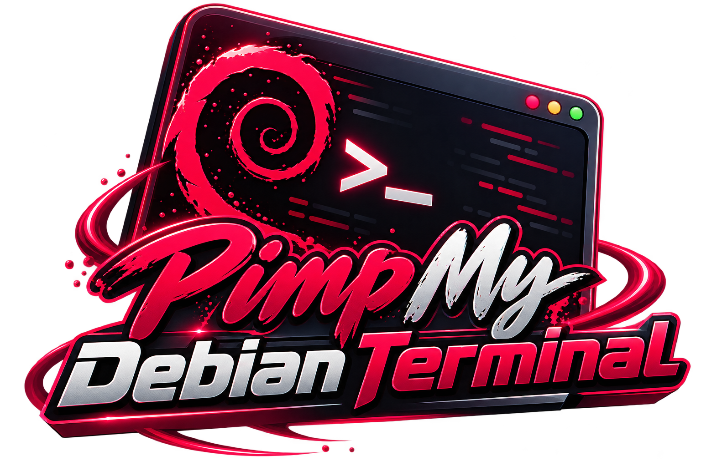
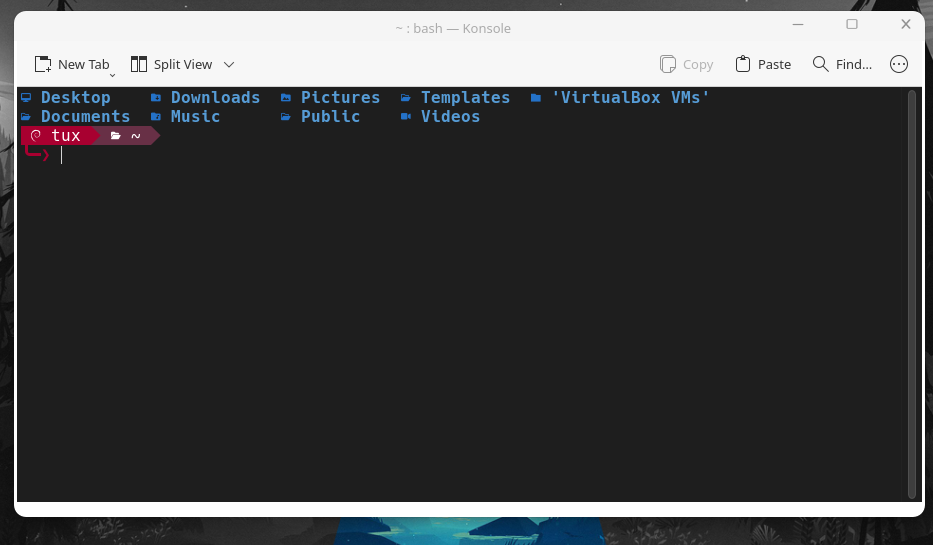

<div align="center">
  

  # Pimp My Debian Terminal

  **A little Debian personality for an everyday Bash terminal.**

  Debian 13 · Bash · KDE Konsole · Hack Nerd Font · eza · Powerline-inspired prompt
</div>



## Why I built this

I spend a lot of time in the terminal. I wanted my Debian desktop to feel like *mine*: a distinctive prompt, readable colors, useful file icons, and a clear reminder when I'm working as root. I didn't want to replace Bash with Zsh or add a prompt framework just to change how my shell looks.

This repository is the result of that small personal experiment. It's not a "perfect desktop" recipe and it isn't meant to be a giant dotfiles framework. It's simply the setup I enjoy using, written down so I can reproduce it later—and so someone else can borrow the parts they like.

The name pays tribute to the broader **Pimp My Terminal** idea. The configurations and documentation here are tailored to my Debian setup.

## What's included

- A two-line **Debian Crimson** Bash prompt with Debian and folder glyphs and Powerline-style separators.
- A visually different **root prompt** labelled `ROOT`, ending with `#` rather than the user's `❯`.
- A Konsole profile using **Hack Nerd Font Mono 12 pt**, a blinking I-beam cursor, and no terminal bell.
- A Konsole color scheme inspired by **VS Code Dark+**: dark `#1E1E1E` background and subtle ANSI colors.
- An optional `eza` alias for `ls` with directory-first ordering and icons.
- Separate, optional installers that make timestamped `.bashrc` backups.

The screenshot is from a real Debian/Konsole session. The logo is an illustrative project graphic, not an official Debian endorsement.

## Requirements

- Debian 13 or another Linux distribution with **Bash**, **Konsole**, and a true-color terminal.
- **eza**, if you want the `ls` alias (otherwise remove the alias line in `bash/user-prompt.bash`).
- **Hack Nerd Font Mono**, installed separately, for the Debian (``), folder (``), and Powerline (``) symbols.
- No Zsh, Oh My Zsh, Starship, or Powerlevel10k required.

On Debian, you can install the packaged dependencies with:

```bash
sudo apt update
sudo apt install konsole eza
```

Nerd Fonts: download Hack from the official [Nerd Fonts releases](https://github.com/ryanoasis/nerd-fonts/releases) and install it for your user, then select **Hack Nerd Font Mono** in Konsole. Font files are **not** bundled in this repository.

## Install on your regular account

Read the scripts before executing them. Unzip or clone the repository, open a terminal in the project directory, and choose either the manual or automated approach.

**Option A — manual (best if you already maintain your own `.bashrc`):**

1. Back up your current configuration: `cp ~/.bashrc ~/.bashrc.backup-before-crimson`.
2. Open `bash/user-prompt.bash`, review the alias and prompt, and copy the configuration into the **end of your existing `~/.bashrc`**. If your `.bashrc` already sets `PS1` elsewhere, the last assignment will normally win.
3. Open a new Bash terminal. If the glyphs look wrong, check your Nerd Font before changing anything else.

**Option B — installer:**

```bash
bash scripts/install-user.sh
```

The installer creates a timestamped backup and appends a **marked source block** to `~/.bashrc`. It will not append a second block if the marker already exists. **Keep the repository in the same location**, because `.bashrc` will source `bash/user-prompt.bash` from its original path.

> Already using a Debian Crimson prompt? Do not stack this on top of an older `PS1`/`alias ls` customization without checking your `.bashrc`. Review or remove your older block first to avoid duplicate behavior.

## Install the Konsole look

For a new installation, copy the two Konsole files:

```bash
bash scripts/install-konsole.sh
```

This backs up same-named files before copying them into `~/.local/share/konsole/`. In **Konsole → Settings → Edit Current Profile → Appearance**, choose **VS Code Dark+**. Set **Tux_Debian** as the active/default profile if you want the included font, cursor, and bell preferences. You can instead use the color scheme with your own profile.

The theme file is our **Konsole adaptation inspired by Dark+**, not a copy of the official VS Code theme package. It does not change KDE Plasma colors or your desktop panel.

## Root prompt (optional)

I like having a warning I can see at a glance when a shell is running with administrator privileges. The root prompt uses the same crimson/wine blocks as my regular prompt, but says **ROOT** in bold and uses `╰─#` for the command line. It is a *visual cue only*, not a security control.

You must choose to install this separately. Review `bash/root-prompt.bash` first. The root installer edits only `/root/.bashrc`, makes a timestamped backup, and does **not** change your user prompt.

```bash
sudo bash scripts/install-root.sh
```

If your system uses `su -` instead of `sudo`, enter an authenticated root shell and run `bash scripts/install-root.sh` from the project directory. Start a **new root Bash shell** to see the prompt. It will only render the intended glyphs if the terminal emulator uses a Nerd Font. The installer copies the root prompt into `/root/.config/debian-crimson/root-prompt.bash` with restrictive permissions. Root does **not** source executable shell code from a directory controlled by the regular user.

**Please do not stay logged in as root for routine work.** A red prompt is not protection against a mistaken privileged command.

## Customization

| Item | Location | Current value |
| --- | --- | --- |
| User prompt | `bash/user-prompt.bash` | Crimson `#A80030`, wine `#683046` |
| Root prompt | `bash/root-prompt.bash` | Label `ROOT` and red `╰─#` |
| Konsole profile | `konsole/Tux_Debian.profile` | Hack Nerd Font Mono, 12 pt |
| Color scheme | `konsole/VSCode-DarkPlus.colorscheme` | Dark+ inspired, `#1E1E1E` |
| Screenshot | `screenshots/debian-crimson-konsole.png` | Regular user's desktop |

The prompt uses ANSI true-color sequences directly in Bash `PS1`; it doesn't call an external prompt engine. The `eza` alias is optional; adjust it to match your own workflow. Some shell integrations or other plugins may override `PS1`, so compare your final `.bashrc` if the prompt doesn't appear.

## Undo / restore

The installers create backups named like `.bashrc.backup-pmdt-YYYYMMDD-HHMMSS` in the same directory as the original.

- **Regular user:** open `~/.bashrc` and remove the marked `Debian Crimson (pimp-my-debian-terminal)` block, or restore the correct backup after checking the timestamp. Open a new shell afterward.
- **Root:** as root, open `/root/.bashrc` and remove its marked `Debian Crimson ROOT` block, or restore the backup that was created for the root account. You may also remove `/root/.config/debian-crimson/` after confirming nothing sources it.
- **Konsole:** select a different profile/color scheme; the Konsole installer also backs up any files it overwrites with `.backup-pmdt-...` suffixes.

Never blindly overwrite a newer `.bashrc` with an old backup: it could erase unrelated changes you made afterward.

## A note about ChatGPT and how I work

I use **ChatGPT as a tool throughout my learning and development process**. It helps me explore options, understand commands, review configuration ideas, improve technical writing, and spot things I might have overlooked.

I don't want to hide that. The prompts, choices, terminal experiments, screenshots, and direction of this project come from my own hands-on work on Debian, with ChatGPT helping me reason through problems and document what I learned. I test changes locally and decide what to keep. The responsibility for what I publish is mine.

I believe being open about AI assistance is better than pretending everything was written in isolation. I also believe reading the commands and understanding the system is more important than copying a configuration blindly.

## Credits and licensing

- Debian and the Debian swirl are associated with the [Debian Project](https://www.debian.org/logos/). This project is independent and not affiliated with or endorsed by Debian.
- [Nerd Fonts](https://www.nerdfonts.com/) supplies the font glyph ecosystem. Font files are not redistributed here.
- [eza](https://github.com/eza-community/eza) provides the optional icon-aware file listing.
- Color inspiration: [Visual Studio Code](https://code.visualstudio.com/) Dark+ and the [Dracula](https://draculatheme.com/) theme that I tested earlier. The Dracula color file is **not** redistributed.
- The terminal customization was inspired by the wider [Pimp My Terminal](https://drasite.com/blog/Pimp%20my%20terminal) community.

Project scripts and documentation are released under the **MIT License** (see `LICENSE`). Third-party names/logos remain with their respective owners; the generated artwork is provided for this project's presentation without making any claim over third-party trademarks.

---

Built on Debian, learned by experimenting, and documented so I can do it again.
